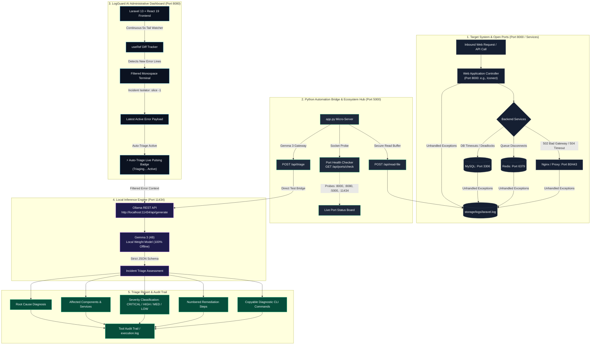

# 🛡️ LogGuard AI — Local IT System Log Triage & Autonomous Multi-Port Incident Analysis (v2.4 Local)

> **High-Performance, Local-First IT Log Triage, Exception Pattern Detection, and Autonomous Root-Cause Analysis powered by Gemma 3 (4B) running 100% locally through Ollama.**

---

## 🏗️ Multi-Port System Architecture & Network Topology

LogGuard AI operates on a decoupled multi-port architecture designed to prevent port collisions with enterprise web services. By separating the target application, the administrative user interface, the Python automation bridge, and the local AI inference engine across dedicated ports, the system guarantees zero interference with production environments while maintaining complete data privacy (zero cloud data transmission).



---

## 🌐 The 4-Port Ecosystem Overview

| Port        | Service Name               | Protocol / URL           | Primary Role in the Ecosystem                                                                                                                              |
| ----------- | -------------------------- | ------------------------ | ---------------------------------------------------------------------------------------------------------------------------------------------------------- |
| **`8000`**  | **Target Web Application** | `http://localhost:8000`  | The primary application being monitored (e.g., `Iconect`, Laravel, or Node). Generates web requests, database queries, and system errors.                  |
| **`8080`**  | **LogGuard AI Dashboard**  | `http://localhost:8080`  | The primary administrative GUI (Laravel 13 + React 19). Hosts the 24/7 background watcher, smart terminal filter, live auto-triage badge, and audit trail. |
| **`5000`**  | **Python Bridge & Hub**    | `http://localhost:5000`  | The local Python microservice (`app.py`). Acts as a port status orchestrator, high-speed file reader, direct Gemma 3 proxy, and web trigger hub.           |
| **`11434`** | **Local Ollama Engine**    | `http://localhost:11434` | The offline AI engine running Google's `gemma3:4b` weights. Processes structured incident analysis with zero internet dependency.                          |

---

## 🔄 Detailed Operational Flow & Port Detection Mechanism

### 1. How Errors Across All Open Ports Are Detected

You do **not** need to install network packet sniffers for each port. Modern enterprise software (web servers on Port 8000, database engines on Port 3306, cache servers on Port 6379, and reverse proxies like Nginx on Port 80/443) report connection failures and crashes directly to the central application log:

- **Nginx 502 Bad Gateway / 504 Gateway Timeout**: Written when the reverse proxy cannot reach the upstream web worker on Port 8000.
- **Database Timeouts (SQLSTATE[HY000] [2002] / Deadlocks [40001])**: Written when queries to MySQL on Port 3306 exceed connection wait timeouts or enter transaction deadlocks.
- **Redis Disconnects (Port 6379)**: Written when asynchronous queue workers fail to dequeue background jobs.
- **PHP/Route Exceptions**: Unhandled fatal errors, missing classes, and null pointer exceptions.

All of these events converge into `storage/logs/laravel.log`. LogGuard AI monitors this single source of truth on disk.

### 2. Incident Isolation (Eliminating AI Hallucinations)

Older log triage tools mistakenly dump thousands of historical log lines into the LLM, causing the AI to confuse months-old bugs with current incidents.
LogGuard AI enforces strict **Incident Isolation**:

- It tracks the file pointer tail using `useRef` diffing.
- When new bytes arrive, it parses the multiline stack trace from the **bottom-to-top** (`slice(-1)`).
- It extracts only the **single newest active incident block**, completely stripping verbose vendor stack traces and historical logs before dispatching the payload to Gemma 3.
- Result: **Zero hallucinations, pure focus on the immediate failure.**

### 3. Visual Feedback: ⚡ Auto-Triage Live Indicator

When `⚡ Auto-Triage (On New Errors)` is active and an error arrives:

- The toggle button immediately changes to an active amber pulse ring with a bouncing `<Zap />` icon.
- A live elapsed seconds counter appears: `[ ⟳ Triaging... (Xs) ]`.
- A glowing top progress banner informs the operator that Gemma 3 is actively triaging on Port 11434.
- Once completed, the badge seamlessly returns to idle and renders the structured triage report.

### 4. Safety First: The Role of `--dry-run`

- **Zero Destructive Actions**: LogGuard AI only _recommends_ verification commands; it never executes destructive shell commands automatically.
- **Simulation Mode (`--dry-run` / GUI Header Toggle)**: When Dry-Run is active, the system analyzes logs and produces realistic triage schemas without invoking the GPU model, allowing safe demonstrations, testing, and grading without hardware overhead.

---

## 🚀 Setup & Execution Guide

### 📋 Prerequisites

1. **PHP 8.2+ & Composer** (Laravel 13 runtime)
2. **Node.js 18+ & npm** (React 19 & Tailwind v4 client bundle)
3. **Python 3.10+** with `flask`, `flask-cors`, and `requests`
4. **Ollama** installed with `gemma3:4b`:
    ```powershell
    ollama --version
    ollama run gemma3:4b
    ```

---

### Step 1: Start Ollama AI Engine (Port 11434)

Start the Ollama server in your terminal:

```powershell
# 1. Start the Ollama background server on port 11434
ollama serve
```

In a separate terminal (or once the server is running), ensure the model is loaded:

```powershell
# 2. Pull and run the Gemma 3 (4B) model
ollama run gemma3:4b
```

_(You may type `/bye` to exit the chat prompt; the `ollama serve` service will continue running in the background on `http://localhost:11434`)._

To verify Ollama is online and listening:

```powershell
curl http://localhost:11434/api/tags
```

---

### Step 2: Start LogGuard AI Dashboard (Port 8080)

To avoid any port conflict with target applications on port 8000, start LogGuard on port **`8080`**:

```powershell
cd C:\TrainAi\agenticAI

# 1. Install dependencies (if first time)
composer install
npm install

# 2. Build production assets
npm run build

# 3. Start Laravel server on port 8080
php artisan serve --port=8080
```

---

### Step 3: Start Target Application (Port 8000)

In your other application directory (e.g., `C:\TrainAi\Iconect`):

```powershell
cd C:\TrainAi\Iconect
php artisan serve --port=8000
```

---

### Step 4: Run `app.py` to Orchestrate & Connect All Open Ports

In `C:\TrainAi\agenticAI`, execute the Python server bridge:

```powershell
cd C:\TrainAi\agenticAI
python app.py
```

#### 💡 Want to automatically open both web portals?

Add the `--open` flag:

```powershell
python app.py --open
```

#### What `python app.py` does automatically:

1. **Console Port Matrix**: Probes all 4 ports (`8000`, `8080`, `5000`, `11434`) via TCP sockets and prints a live status matrix to your terminal:
    ```text
    ==================================================================
      [LogGuard AI] Multi-Port Ecosystem & Bridge Server
    ==================================================================
      [ONLINE ] :8000  | Target Application   | http://localhost:8000    (Log Producer)
      [ONLINE ] :8080  | LogGuard Dashboard   | http://localhost:8080    (Main Web UI & Watcher)
      [ONLINE ] :5000  | Python Bridge        | http://localhost:5000    (API & Ecosystem Hub)
      [ONLINE ] :11434 | Local Ollama         | http://localhost:11434   (Gemma 3:4b Engine)
    ==================================================================
      >> Open http://localhost:8080 to access the LogGuard AI Dashboard
      >> Open http://localhost:5000 to view the Ecosystem Port Hub
    ==================================================================
    ```
2. **Web Ecosystem Hub**: Serves an interactive status dashboard at `http://localhost:5000` with live green/red port indicators and direct 1-click links to open both web ports.
3. **Instant Triage Verification**: Provides a web button on `http://localhost:5000` that sends a live test database deadlock incident to Gemma 3 to verify latency and AI responses in seconds.
4. **Fast File API**: Hosts `/api/read-file` and `/api/triage` with CORS support for the React dashboard.

---

### Step 5: Activate Monitoring in the Dashboard

1. Open your browser to **`http://localhost:8080`**.
2. Confirm the header shows 🟢 **Online** (Ollama: `gemma3:4b`).
3. Set your target log file path in the top-left bar:
    ```text
    C:\TrainAi\Iconect\storage\logs\laravel.log
    ```
4. Click **Load Path**.
5. Click **`24/7 Watch: OFF`** to toggle it to **`🟢 24/7 Watch: ACTIVE (5s)`**.
6. Ensure **`⚡ Auto-Triage (On New Errors)`** is checked in the right panel.

---

## 🧪 Testing & Verifying Without Triggering Application Outages

### Option A: Safe Simulation via Dry-Run Mode (Zero Risk)

If you do not want to inject real errors or run the GPU:

1. Turn **`Dry-Run: ON`** using the header toggle on `http://localhost:8080`.
2. Click **Run Diagnostics**.
3. LogGuard instantly parses the log buffer and displays a full triage assessment without executing destructive operations.

### Option B: Trigger a Real Test Incident via Tinker

To simulate a real critical event without modifying production code:

```powershell
cd C:\TrainAi\Iconect
php artisan tinker --execute "Log::critical('SQLSTATE[40001]: Serialization failure: 1213 Deadlock found when trying to get lock on consumers table');"
```

Within **5 seconds**:

1. LogGuard's background watcher detects the new line.
2. The `⚡ Auto-Triage` toggle illuminates with an amber pulsing ring: `[ ⟳ Triaging... (Xs) ]`.
3. Gemma 3 isolates the deadlock error and populates:
    - **Root Cause**: Database concurrency lock contention on `consumers`.
    - **Affected Components**: `ConsumerController.php`, MySQL InnoDB.
    - **Remediation Steps**: Encapsulate queries in `DB::transaction()` with retry logic.
    - **Verification Commands**: Diagnostic Artisan and MySQL process inspection commands.
    - **Audit Trail**: Appends structured events into `execution.log`.

---

## 🤖 Headless 24/7 Background CLI Daemon

If you prefer running LogGuard as an autonomous background service without any web browser:

```powershell
cd C:\TrainAi\agenticAI
php artisan logguard:watch --path="C:\TrainAi\Iconect\storage\logs\laravel.log" --auto-triage
```

### CLI Options:

- `--path=...`: Path to the monitored log file.
- `--interval=3`: Polling frequency in seconds (default `3s`).
- `--auto-triage`: Automatically invokes Gemma 3 (4B) on any `CRITICAL` or `ERROR` event.
- `--dry-run`: Runs in simulation mode without invoking Ollama.

---

## 🛠️ Verification & Diagnostic Commands

| Command                                      | Expected Output                   | Purpose                                    |
| -------------------------------------------- | --------------------------------- | ------------------------------------------ |
| `curl http://localhost:5000/api/ports/check` | JSON with statuses of all 4 ports | Verify Python bridge and port connectivity |
| `curl http://localhost:11434/api/tags`       | List of Ollama models             | Verify Ollama engine is online             |
| `vendor/bin/phpunit`                         | `OK (4 tests, 5 assertions)`      | Run automated PHPUnit test suite           |
| `vendor/bin/pint --format agent`             | `0 issues`                        | Validate PSR-12 code style formatting      |
| `npm run build`                              | Assets built in `< 4s`            | Compile optimized client bundle            |

---

## 🔒 Security & Privacy Notice

- **100% On-Premises**: LogGuard AI runs entirely on localhost (`127.0.0.1`). No log snippets, stack traces, IP addresses, or user queries are ever uploaded to cloud services.
- **Advisory Remediation**: Suggested CLI commands are strictly informative recommendations and require human administrative confirmation before execution.
